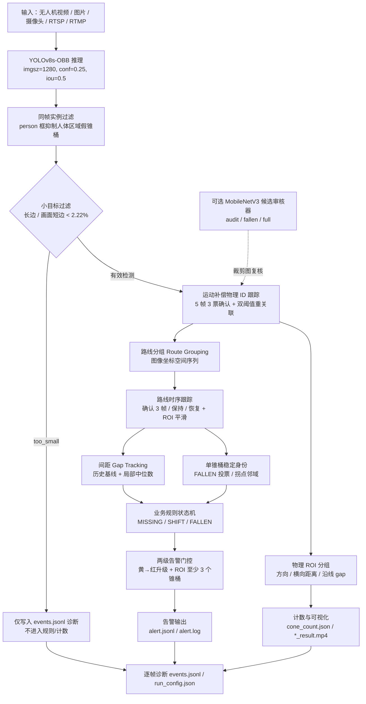
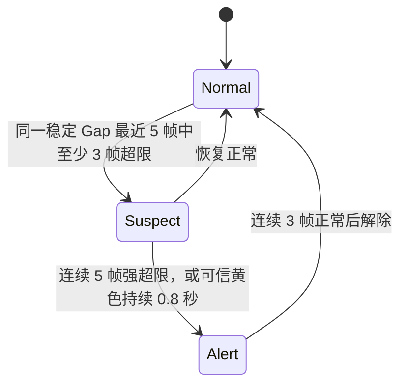

# 交通锥 OBB 检测与异常监测（UAV Cone Monitoring）

面向**无人机道路施工导改场景**的交通锥检测与异常监测系统：一个 `YOLOv8s-OBB` 三分类检测器负责「看到什么」，一套**纯几何 + 时序状态机**的后处理负责「哪里不对」，最终输出可直接人工复查的结构化告警。

[](https://github.com/SolitudeZY/UAV_cone)


> **阅读顺序建议**
> 1. 本文件（项目总览、命令入口、模块地图）；
> 2. [`CURRENT_STATE_FOR_GPT.md`](CURRENT_STATE_FOR_GPT.md) —— **当前开发状态的第一手记录（2026-09-10）**，包含可用的环境、数据集、权重路径与 SHA-256、已知边界。与本文件或其他历史文档冲突时，**以该文件为准**；
> 3. [`script/README.md`](script/README.md) —— 详版参数手册（28 KB），逐项解释每个 CLI 开关的物理含义；
> 4. 需要设计背景时再看 [`文档索引`](#15-文档索引) 列出的专题文档。

---

## 目录

- [1. 项目定位](#1-项目定位)
- [2. 技术栈](#2-技术栈)
- [3. 核心特性](#3-核心特性)
- [4. 系统架构](#4-系统架构)
- [5. 目录结构](#5-目录结构)
- [6. 关键模块](#6-关键模块)
- [7. 环境安装](#7-环境安装)
- [8. 数据构建与训练](#8-数据构建与训练)
- [9. 推理与告警输出](#9-推理与告警输出)
- [10. 关键参数速查](#10-关键参数速查)
- [11. 输出产物与字段](#11-输出产物与字段)
- [12. 业务规则约束](#12-业务规则约束)
- [13. 测试](#13-测试)
- [14. CVAT 与 nuclio 部署](#14-cvat-与-nuclio-部署)
- [15. 文档索引](#15-文档索引)
- [16. 已知限制与后续计划](#16-已知限制与后续计划)

---

## 1. 项目定位

无人机沿施工导改路段巡航拍摄，画面的**透视关系、目标尺度、可见路线成员**随时在变。单纯的目标检测只能回答「这一帧有几个锥桶」，而业务真正关心的是三类异常：

| 异常 | 业务含义 | 系统输出 |
| --- | --- | --- |
| **MISSING** | 路线中间缺失锥桶（导改线断开） | 连续多帧确认后升级为红色告警 |
| **SHIFT** | 锥桶横向偏移，路线发生变形 | 排除合法拐点后报红色告警 |
| **FALLEN** | 锥桶倒伏 | 单锥桶稳定 ID 多帧投票后报红色告警 |

本项目的核心思路是：**让检测器只负责「检测」，让几何与时序规则负责「判断」**。检测结果先按物理空间分组为路线（Route / ROI），再在路线内跟踪「间距（Gap）」和「成员（锥桶）」的跨帧身份，最后用多帧投票与状态机把逐帧抖动过滤成稳定告警。这条链路上的参数与阈值全部可复现、可 A/B、可写入 `run_config.json`。

**仓库边界**：本仓库只托管**代码与文档**（数百 KB 量级）。数据集、权重（`*.pt`）、推理产物、测试视频体积达 GB 级，全部由 [`.gitignore`](.gitignore) 排除。以服务器工作副本 `/mnt/cn600_1tb/ZY/traffic_cone` 为例：`dataset/` 约 16 GB、`script/runs/` 约 27 GB，合计约 43 GB，均**不进入版本控制**。

## 2. 技术栈

| 层次 | 选型 | 说明 |
| --- | --- | --- |
| 检测器 | `YOLOv8s-OBB`（Ultralytics），三分类 `cone / traffic_sign / person` | 训练尺寸 960，无人机远距小目标推理默认 1280 |
| 候选审核器（可选） | `MobileNetV3-small`，`upright_cone / fallen_cone / not_cone` 三类 | 对 YOLO 候选裁剪图做真假/姿态复核；标注时的 `ignore` 仅用于排除样本，不是模型类别（早期方案文档称「二分类器」，落地为三分类） |
| 业务后处理 | 纯 Python 几何 + 时序状态机，无额外深度学习 | 路线分组、间距基线、投票防抖、拐点豁免 |
| 运行时 | Python 3.10 / 3.11，PyTorch、Ultralytics、OpenCV | 依赖见 [`script/requirements.txt`](script/requirements.txt) |
| 视频/推流 | OpenCV 编解码 + `ffmpeg` / `ffprobe` | RTMP 拉流→推理→重推流 |
| 模型部署 | CVAT + nuclio（ONNX 函数） | 见 [`cvat-nuclio-model-deployment/`](cvat-nuclio-model-deployment/SKILL.md) |
| 环境管理 | Conda，环境名 `yolo-obb` | [`script/environment.yml`](script/environment.yml) |

## 3. 核心特性

- **三类别 OBB 检测**：`cone`（锥桶）、`traffic_sign`（交通标志）、`person`（人员）。`person` 框用于**同一帧内抑制人体区域里的假锥桶**（反光服、人影），不需要额外的二阶段人员模型，也不产生第二次完整前向的 FPS 开销；历史四分类权重可用 `--exclude-classes person,vest` 兼容。
- **路线分组 Route Grouping**：默认以「中心距离 ≤ 局部最近邻间距的 3.0 倍」把锥桶聚成连续序列，相距较远的锥桶列分别排序、连线、判定，不会跨列连接。
- **间距平滑 Gap Tracking**：每个稳定 ROI 独立学习「正常间距」历史基线（最近 30 帧高支持度帧的中位数），并对**近距污染**（无人机飞近导致锥桶突然放大）做上限与异常样本过滤，避免单一全局阈值造成的漏报/误报。
- **多帧投票防抖**：同一个稳定 Gap 需在最近 5 帧中至少 3 帧为候选才进入黄色 `MISSING?`；强超限连续 5 帧或可信黄色持续 0.8 秒才升级红色 `MISSING`；同类型告警只在**激活瞬间**写一条日志。
- **物理 ID 与物理 ROI**：运动补偿后为每个锥桶分配跨帧物理 ID（最近 5 帧至少 3 次观察确认，最多保持 12 个漏检帧），并按参考平面中的方向/横向距离/沿线 gap 分成物理 ROI；这是计数与 ROI 绘制的数据源。
- **透视校正换算到米**：在针孔相机平地模型下，用光轴俯角 `--camera-pitch-deg` + 当前焦段水平视场角 `--camera-hfov-deg` 把像素距离校正为地面距离；再给出 `--drone-altitude-m` 才输出米制，否则单位为「相机离地高度的倍数」。
- **可选候选审核器**：`MobileNetV3-small` 提供 `audit`（只记录）、`fallen`（补倒伏票）、`full`（剔除 `not_cone` 候选）三种模式，默认推荐 `fallen`。
- **结构化告警输出**：`events.jsonl`（逐帧诊断）、`alert.jsonl`（结构化告警激活）、`alert.log`（人工复查纯文本）、`cone_count.json`（计数）、`run_config.json`（参数与模型/视频 SHA-256）。
- **实时推流链路**：`stream_obb_rtmp.py` 拉取 RTMP 流、逐帧 OBB 推理、把标注画面重新推流。

## 4. 系统架构



告警状态的升级与解除（以 Gap/MISSING 为例，默认参数）：



处理阶段与对应模块：

| 阶段 | 承担模块 | 作用 |
| --- | --- | --- |
| ① 检测 | `infer_obb.py` + Ultralytics | 输出三类 OBB，同帧 `person` 抑制假锥桶 |
| ② 过滤 | `infer_obb.py` | 小目标（`too_small`）在空间与时序规则之前排除 |
| ③ 身份 | `uav_physical_cone_counter.py`、`cone_counter.py` | 运动补偿物理 ID、单锥桶稳定轨迹与计数 |
| ④ 分组 | `traffic_rules.py`、`route_tracker.py` | 空间路线分组 + 跨帧稳定 ROI |
| ⑤ 度量 | `gap_tracker.py`、`ground_projection.py` | 每个稳定 Gap 的基线、倍率、透视校正与单位换算 |
| ⑥ 判定 | `traffic_rules.py`、`fallen_tracker.py`、`shift_tracker.py` | MISSING / SHIFT / FALLEN 的几何与时序判定 |
| ⑦ 输出 | `alert_logger.py`、`infer_obb.py` | 两级门控、告警激活记录、视频渲染与 JSONL 落盘 |

## 5. 目录结构

```text
.
├── README.md                       # 本文件：项目总览、架构、命令入口
├── CURRENT_STATE_FOR_GPT.md        # 当前状态交接：环境、数据集、权重、命令、已知边界（最高优先级）
├── AGENT.md                        # 给 AI 编码代理的工程约定：输出契约、已确认缺陷、验收要求
├── AGENTS.md                       # 更精简的入口指引，指向 CURRENT_STATE_FOR_GPT.md
├── CONTEXT.md                      # 候选审核环节的术语表（upright / fallen / not_cone / ignore）
├── .gitignore                      # 排除数据集、权重、推理产物与测试视频
├── script/                         # 核心代码：训练、推理、业务规则、数据与审核工具
│   ├── README.md                   # 详版参数手册（28 KB），本项目参数的第一手说明
│   ├── infer_obb.py                # 生产式推理入口：检测→物理 ID→路线→规则→告警
│   ├── traffic_rules.py            # 纯几何规则：路线排序、MISSING/SHIFT/FALLEN 几何判定
│   ├── environment.yml             # conda 环境定义（yolo-obb, Python 3.11）
│   ├── requirements.txt            # pip 依赖清单
│   ├── archive/                    # 已归档脚本（保留可追溯，不参与主链路）
│   └── runs/                       # 训练与推理产物（不入库，约 27 GB）
├── dataset/                        # 数据集（不入库，约 16 GB）
├── doc/                            # 早期设计与问题分析文档（本地保留，被 .gitignore 排除，未纳入 Git）
├── cvat-nuclio-model-deployment/   # CVAT + nuclio 的 ONNX 模型部署 skill、检查脚本与排障参考
└── *.pt                            # 预训练/基线权重（yolov8s-obb.pt 等，不入库）
```

各目录一句话说明：

| 路径 | 说明 |
| --- | --- |
| [`script/`](script/) | 全部可执行代码。主链路是 `infer_obb.py`，规则在 `traffic_rules.py` / `gap_tracker.py` / `route_tracker.py` / `fallen_tracker.py`；`archive/` 存放 2026-08-27 清理时移出的历史脚本（保留原文件与 `FILES.sha256`） |
| `dataset/` | YOLO OBB 数据集与候选分类器数据集，按日期/实验命名（如 `2026-08-14-merged-3class-no-tiny-raw1`），**不入库** |
| `doc/` | 早期 PRD 与问题分析（如无人机巡航自适应 ROI 时序稳定 PRD、SHIFT/MISSING 误报问题分析）。当前被 `.gitignore` 排除，仅在本地工作副本存在 |
| [`cvat-nuclio-model-deployment/`](cvat-nuclio-model-deployment/SKILL.md) | CVAT 自动标注函数（nuclio）的部署与排障流程：`function.yaml`/`Dockerfile`/handler 检查、镜像构建、`nuctl` 部署、HTTP 端点与 CVAT 元数据验证 |
| `script/runs/` | 训练输出（`weights/best.pt`、`results.csv`）与推理输出（`*_result.mp4`、各类 JSONL），**不入库** |

## 6. 关键模块

### 6.1 主链路（推理与业务规则）

| 模块 | 职责 | 关键点 |
| --- | --- | --- |
| [`script/infer_obb.py`](script/infer_obb.py) | 生产式推理入口与输出编排：在图片/视频上执行 OBB 推理并应用交通锥空间规则 | 2262 行。串联检测、物理 ID、路线跟踪、Gap/Shift/Fallen 状态机、绘图与五个输出文件；参数全部写入 `run_config.json` |
| [`script/traffic_rules.py`](script/traffic_rules.py) | 纯几何规则层，**不依赖推理运行时** | 812 行。定义 `ConeDetection` / `AnalysisResult`，负责路线排序（`order_along_route`）、局部参考间距、MISSING/SHIFT/FALLEN 的几何判定与 SHIFT 拐点豁免（`_supported_shift_corners`） |
| [`script/route_tracker.py`](script/route_tracker.py) | 跨帧持续跟踪路线，输出时间上稳定的 ROI | 602 行。以最小代价分配（`_minimum_cost_assignment`）匹配前后帧路线，维护 `tentative/confirmed/held` 状态、平滑边界与主方向 |
| [`script/gap_tracker.py`](script/gap_tracker.py) | 每个稳定路线内 Gap 的身份、阈值、历史基线与告警投票 | 829 行。核心数据结构 `GapRouteThreshold`、`TrackedGap`、`GapAlertPolicy`；实现近距污染保护、近邻污染排除与黄→红状态迁移 |
| [`script/fallen_tracker.py`](script/fallen_tracker.py) | 单锥桶稳定身份 + 时序 FALLEN 确认 | 276 行。`ConeTrackRegistry` 按局部锥距与运动预测关联锥桶，累计 `7 帧 / 5 票` 后才激活 |
| [`script/shift_tracker.py`](script/shift_tracker.py) | 路线级 SHIFT 告警的时序确认 | 53 行。把逐帧 `displaced` 累积成需连续 N 帧才成立的业务告警 |
| [`script/uav_physical_cone_counter.py`](script/uav_physical_cone_counter.py) | 运动补偿物理 ID 与物理 ROI 的独立实现与对比实验入口 | 1403 行。`GroundMotionEstimator`（背景点估计帧间地面运动）、`PhysicalTrack`、`PhysicalRoiTracker`。**刻意独立**：不运行也不修改 FALLEN/SHIFT/MISSING 规则，便于 A/B |
| [`script/cone_counter.py`](script/cone_counter.py) | 单锥桶稳定跟踪与视频级计数 | 240 行。`ConeCounter` 输出 `stable_visible_count` / `unique_seen_count` 等统计，供 `cone_count.json` |
| [`script/ground_projection.py`](script/ground_projection.py) | 斜视图像与平面地面之间的针孔投影 | 111 行。`GroundPlaneProjector` 把像素距离换算为地面距离（`camera_heights` 或米） |
| [`script/alert_logger.py`](script/alert_logger.py) | 只记录「状态转换」的简洁业务告警日志 | 78 行。`AlertJournal` + `format_review_alert`，保证同一持续告警不会每帧写一行 |
| [`script/infer_dual_model.py`](script/infer_dual_model.py) | 可审计的 YOLO OBB + MobileNet 双模型视频推理 | 443 行。独立入口，用于对比「加/不加分类器」的行为差异，`script/runs/dual_model_eval_*` 为其评估产物 |
| [`script/cone_candidate_classifier.py`](script/cone_candidate_classifier.py) | MobileNet 候选审核的运行时封装 | 163 行。`load_thresholds` 从权重同目录读取 `thresholds.json`，`ConeCandidateClassifier` 输出三分类概率与决策 |
| [`script/stream_obb_rtmp.py`](script/stream_obb_rtmp.py) | 拉 RTMP 流 → OBB 推理 → 重推标注流 | 291 行。用 `ffprobe` 探测分辨率/帧率，`ffmpeg` 解码与编码，支持断流重连与最大帧数 |

### 6.2 数据、训练与评估

| 模块 | 职责 | 关键点 |
| --- | --- | --- |
| [`script/train_obb.py`](script/train_obb.py) | 训练实时 YOLO OBB 检测器 | 187 行。默认 `yolov8s-obb.pt` / 150 epochs / `imgsz=960` / `batch=16`；自动生成可移植的 resolved data 配置，支持 `--resume` |
| [`script/build_fused_dataset.py`](script/build_fused_dataset.py) | 由锥桶 OBB 数据 + PPE AABB 数据构建**四分类**融合 OBB 数据集 | 273 行。人员水平框转四点 OBB，图片默认硬链接，训练集锥桶重复 3 份以缓解类别偏置，拒绝覆盖非空输出目录 |
| [`script/convert_obb_classes.py`](script/convert_obb_classes.py) | 从四分类数据集生成**三分类**数据集 | 266 行。仅删除 `vest` 标签行，保留划分与图片，在 `manifest.json` 记录转换前后对象数 |
| [`script/extend_fused_dataset.py`](script/extend_fused_dataset.py) | 用已审核的 train-only 源扩展已有融合数据集 | 341 行。新增数据只进 train，val/test 保持不变，审计哈希写入 manifest |
| [`script/validate_dataset.py`](script/validate_dataset.py) | 校验 YOLO OBB 标签合法性 | 230 行。可选择性裁剪越界的极小坐标 |
| [`script/audit_obb_dataset.py`](script/audit_obb_dataset.py) | 只读审计一个或多个 OBB 数据集 | 198 行。统计对象数/类别/面积，可输出预览图 |
| [`script/evaluate_obb_checkpoints.py`](script/evaluate_obb_checkpoints.py) | 在**固定部署阈值**下评估多个 OBB checkpoint | 246 行。默认 `imgsz=1280`、`conf=0.25`、polygon IoU 0.5。选模型请用它，不要按 `best.pt` 的修改时间挑 |
| [`script/train_ppe.py`](script/train_ppe.py) | 训练轻量 PPE 检测器（person / 反光服抑制） | 111 行。仅为兼容旧的两分类权重；三分类主方案不需要它 |
| [`script/mine_classifier_candidates.py`](script/mine_classifier_candidates.py) | 用低阈值扫描数据集，挖出可人工审核的候选裁剪图 | 662 行。生成正方形上下文裁剪与带 OBB 轮廓的审核预览 |
| [`script/candidate_review_web.py`](script/candidate_review_web.py) | 候选审核 Web UI（Flask） | 411 行。三个训练类别 + 一个 `ignore`，点击即存、原子写入、刷新不丢进度 |
| [`script/build_cone_classifier_dataset.py`](script/build_cone_classifier_dataset.py) | 由审核结果构建 ImageFolder 数据集 | 334 行。按来源 split 隔离、按裁剪图 SHA-256 去重，`ignore` 完全排除 |
| [`script/train_mobilenet_classifier.py`](script/train_mobilenet_classifier.py) | 训练并独立评估三分类锥桶候选审核器 | 288 行。先训分类头、再解冻末尾 block 微调；按 macro-F1 > 倒伏召回 > 非锥桶召回 > accuracy 选 `best.pt` |
| [`script/mobilenet_classifier.py`](script/mobilenet_classifier.py) | 共享的 MobileNetV3-small 构建、变换与指标 | 128 行 |
| [`script/evaluate_mobilenet_classifier.py`](script/evaluate_mobilenet_classifier.py) | 在未参与的 split 上复评分类型指标 | 53 行 |
| [`script/infer_mobilenet_classifier.py`](script/infer_mobilenet_classifier.py) | 对单图或目录批量输出三分类概率 | 65 行 |
| [`script/calibrate_mobilenet_thresholds.py`](script/calibrate_mobilenet_thresholds.py) | 在校准 split 上标定 `not_cone` 与 `fallen` 阈值 | 236 行。产物即权重同目录的 `thresholds.json` |
| [`script/test_uav_physical_tracking.py`](script/test_uav_physical_tracking.py) | 物理 ID、ROI、route 对齐与告警转换的回归测试 | 691 行，标准库 `unittest`，共 21 项 |

## 7. 环境安装

在仓库根目录执行：

```bash
conda env create -f script/environment.yml
conda activate yolo-obb
```

`script/environment.yml` 定义 Python 3.11 环境 `yolo-obb`，依赖由 `script/requirements.txt` 安装（Ultralytics、OpenCV、PyYAML、SciPy、Flask、PyTorch、torchvision）。

**版本差异提示**：不同机器上的实际推理环境并不一致，行为差异需按「环境」单独验证。例如服务器当前可用环境为 Python 3.10.19 / Torch 2.10.0+cu130 / Ultralytics 8.4.21 / OpenCV 4.13.0，而此前的完整视频验证环境为 Python 3.12.13 / Torch 2.13.0+cu130 / Ultralytics 8.3.253 / OpenCV 4.10.0（来源：[`CURRENT_STATE_FOR_GPT.md`](CURRENT_STATE_FOR_GPT.md) §2）。**换环境后先跑短视频冒烟测试，再跑完整视频**，不要把「模型能加载」等同于行为一致。

## 8. 数据构建与训练

### 8.1 构建数据集

四分类（`cone / traffic_sign / person / vest`）融合数据集：

```bash
python script/build_fused_dataset.py
```

由四分类生成三分类（删除 `vest` 标签行，划分与图片保留）：

```bash
python script/convert_obb_classes.py \
  --source dataset/2026-08-04-long-neg47 \
  --output dataset/2026-08-04-long-neg47-3class
```

用已审核的 train-only 数据扩展已有融合集（val/test 不变）：

```bash
python script/extend_fused_dataset.py --help
```

> 具体输入/输出路径请以 `--help` 与 [`CURRENT_STATE_FOR_GPT.md`](CURRENT_STATE_FOR_GPT.md) §4 的当前数据集为准；本文不重复历史实验的路径组合。

### 8.2 校验与训练

```bash
python script/validate_dataset.py --data-root dataset/2026-08-05-merged-3class
python script/train_obb.py \
  --data dataset/2026-08-05-merged-3class/data.yaml \
  --model yolov8s-obb.pt \
  --device 0 \
  --epochs 150 \
  --batch 16 \
  --imgsz 960 \
  --cache \
  --name traffic_cone_3class_yolov8s_obb_960
```

`train_obb.py` 的默认参数已是「三分类融合数据 + `YOLOv8s-OBB` + 960」，因此也可简写为 `python script/train_obb.py --device 0 --cache`。中断后续训：

```bash
python script/train_obb.py \
  --resume script/runs/traffic_cone_3class_yolov8s_obb_960/weights/last.pt \
  --device 0
```

当前无人机数据的全量微调（更高输入尺寸、AdamW、不冻结骨干）：

```bash
conda run -n yolo-obb python script/train_obb.py \
  --data dataset/2026-08-14-merged-3class-no-tiny-raw1/data.yaml \
  --model yolov8s-obb.pt --device 0 --epochs 150 --imgsz 1280 --batch 1 \
  --workers 8 --patience 30 --optimizer AdamW --lr0 0.001 --lrf 0.01 \
  --warmup-epochs 3 --freeze 0 --save-period 5 \
  --name traffic_cone_uav_20260814_no_tiny_s_full_1280
```

训练输出在 `script/runs/<name>/`：`weights/best.pt`（验证集最优）、`weights/last.pt`、`results.csv` / `results.png`、混淆矩阵与验证预览图。

### 8.3 当前数据集与候选模型（含来源）

以下数字**均引自文档**，本文不另行估算：

| 项目 | 值 | 来源 |
| --- | --- | --- |
| 当前正式数据集 | `dataset/2026-08-14-merged-3class-no-tiny-raw1` | `CURRENT_STATE_FOR_GPT.md` §4 |
| 类别 | `cone / traffic_sign / person` | 同上 |
| train / val / test | 1490 / 320 / 244（文件数 4112，约 3.8 GB） | 同上 |
| 最新候选检测器 | `script/runs/traffic_cone_uav_20260814_no_tiny_s_full_1280/weights/best.pt`（150 epochs，SHA-256 见文档） | 同上 |
| 该候选在固定 244 图测试上的变化 | cone precision 88.50% → 93.15%；multiangle recall 92.58% → 96.51%；但 16 图 original-cone 子集 recall 98.18% → 90.00% | 同上 |
| 候选审核器 | `script/runs/mobilenetv3_small_cone_20260817_v2_context16_bp075/best.pt`，crop context 1.6，阈值同目录 `thresholds.json` | 同上 |
| 该审核器独立测试 | thresholded fallen recall 58/66（87.88%）；`not_cone` 测试支持集仅 13 个 | 同上 |

> 由于 original-cone 子集存在 recall 回退，最新权重是**推理候选**而非自动的生产替代品；切换前用 `evaluate_obb_checkpoints.py` 在固定阈值下对比。

## 9. 推理与告警输出

所有命令在仓库根目录执行。`--source` 支持单张图片、图片目录、视频文件、`rtsp://` 流地址或摄像头编号。

### 9.1 基础推理

```bash
python script/infer_obb.py \
  --weights script/runs/traffic_cone_3class_yolov8s_obb_960/weights/best.pt \
  --source script/test-video/test_10s.mp4 \
  --imgsz 1280 \
  --device 0
```

结果默认写入 `script/runs/infer/`。无人机远距小目标默认 `imgsz=1280`；项目历史实测记录约为 1280 时 90 FPS、960 时 145 FPS，均高于 29.97 FPS 的输入帧率，但 960 下远距锥桶召回明显更低。因此**训练尺寸保持 960、推理尺寸用 1280**，不要用推理尺寸反推训练配置。

### 9.2 物理 ID 与物理 ROI（视频默认开启）

```bash
python script/infer_obb.py \
  --weights script/runs/traffic_cone_uav_20260814_no_tiny_s_full_1280/weights/best.pt \
  --source script/test-video/test_10s.mp4 \
  --imgsz 1280 \
  --device 0 \
  --output script/runs/infer_physical_roi/test_10s
```

默认物理跟踪策略：最近 **5 帧至少 3 次**观察确认；最多保持 **12** 个漏检帧；参考平面匹配距离 **55 px**。检测使用双阈值：`--conf 0.25` 用于新建物理 ID、确认 tentative ID 并进入规则；`--physical-match-conf 0.20` 只允许低置信候选**重关联已确认/保持**的 ID，不创建新 ID、不计数、不进入异常检测。需要退回旧图像坐标模式做 A/B 时加 `--no-physical-roi`。

只比较新旧计数、不跑异常检测时用独立入口：

```bash
python script/uav_physical_cone_counter.py \
  --weights script/runs/traffic_cone_uav_20260814_no_tiny_s_full_1280/weights/best.pt \
  --source script/test-video/test_10s.mp4 \
  --imgsz 1280 --device 0 \
  --output script/runs/uav_physical_dual_conf/test_10s
```

标注视频图例：绿色 OBB 为当前帧检测框；`P<ID>` 为物理 ID；青色 `PHYSICAL ROI <id>` 为一条物理路线的稳定区域；漏检但仍在保持窗口内的 ID 用橙色叉号 + `HOLD` 表示；被尺寸过滤的目标显示灰色 `SMALL`。

### 9.3 接入候选审核器（MobileNetV3）

```bash
PYTHONPATH=script python script/infer_obb.py \
  --weights script/runs/traffic_cone_uav_20260814_no_tiny_s_full_1280/weights/best.pt \
  --source script/test-video/26-08-07-多角度.mp4 \
  --imgsz 1280 --device 0 \
  --classifier-weights script/runs/mobilenetv3_small_cone_20260817_v2_context16_bp075/best.pt \
  --classifier-mode fallen \
  --classifier-crop-context 1.6 \
  --output script/runs/infer_dual_fallen/test_multiangle
```

三种模式的行为差异：

| `--classifier-mode` | 行为 | 是否影响业务结果 |
| --- | --- | --- |
| `audit` | 记录三类概率与决策 | 否 |
| `fallen`（推荐） | `fallen_cone` 作为额外 FALLEN 票，仍需通过原 7 帧/5 票时序；`not_cone` 只记录 | 仅补充倒伏票 |
| `full` | 在 `fallen` 基础上，达到校准阈值的 `not_cone` 在 route 生成前被剔除（视频显示橙色 `REJECT` 框） | 会改变 MISSING / SHIFT / FALLEN，需更充分验证后再启用 |

不传 `--classifier-weights` 时保持原 YOLO + 规则链路。

### 9.4 透视校正（像素 → 米）

只有在**俯角与当前焦段水平视场角都可信**时才启用；再提供相机到锥桶地面的垂直高度才输出米制：

```bash
python script/infer_obb.py \
  --weights script/runs/traffic_cone_3class_yolov8s_obb_960/weights/best.pt \
  --source script/test-video/DJI_1m22s_1m36s.mp4 \
  --imgsz 1280 --device 0 \
  --camera-pitch-deg 45 \
  --camera-hfov-deg 84 \
  --drone-altitude-m 30 \
  --output script/runs/infer_videos_perspective45/DJI_1m22s_1m36s
```

未给高度时单位是 `camera_heights`（相机离地高度的倍数），足以做间距比例与相对偏移判断。固定机位的小范围标定仍可用 `--meters-per-pixel`。画面需保持云台滚转稳定；地面明显起伏、画面被裁切或实际视场角未知时，**保持默认像素模式**。

### 9.5 RTMP 实时推流

```bash
python script/stream_obb_rtmp.py \
  --source rtmp://<host>:<port>/live/<stream-key> \
  --output rtmp://<push-host>/live/traffic_cone_obb \
  --imgsz 1280 --conf 0.25 --iou 0.5 --device 0
```

需要本机可执行 `ffmpeg` / `ffprobe`；支持 `--max-frames`、`--max-reconnects`（0 表示无限）与 `--reconnect-delay`。

### 9.6 最小验证清单

一次「跑通」不等于「验证通过」。按顺序确认：

1. 进程退出码为 0；
2. 输出视频可完整解码，帧数与输入解码帧数一致；
3. `run_config.json` 中的权重/视频 SHA-256 与预期一致；
4. 关键告警片段**人工看一遍**。

## 10. 关键参数速查

以下均为 `infer_obb.py` 的**代码默认值**，完整解释见 [`script/README.md`](script/README.md)。

### 检测与过滤

| 参数 | 默认值 | 说明 |
| --- | --- | --- |
| `--imgsz` | `1280` | 推理输入尺寸（训练默认 960） |
| `--conf` / `--iou` | `0.25` / `0.5` | 高阈值：新建 ID、确认与进入规则 |
| `--min-cone-long-side-ratio` | `0.022222` | OBB 长边须 ≥ 画面短边的 2.22%（1920×1080 约 24 px）；不足者标 `too_small`，不进入规则与计数 |
| `--physical-small-cone-conf` | `0.30` | 尺寸不足但置信度够的候选可**只进入**物理 ID 跟踪 |
| `--exclude-classes` | `person`（默认抑制） | 传 `''` 可关闭同帧人体抑制 |

### 物理 ID 与物理 ROI

| 参数 | 默认值 | 说明 |
| --- | --- | --- |
| `--physical-match-conf` | `0.20` | 低阈值，仅用于重关联已确认/保持的 ID |
| `--physical-max-missed-frames` | `12` | 漏检保持帧数 |
| `--physical-match-distance` | `55.0` | 参考平面匹配距离（像素） |
| `--physical-roi-min-cones` | `2` | 成组最少锥桶数 |
| `--physical-roi-confirm-frames` | `3` | 连续确认帧数 |
| `--physical-roi-lateral-ratio` | `0.6` | 法向距离上限（相对典型间距） |
| `--physical-roi-link-ratio` | `2.5` | 沿线距离超此倍数强制拆组 |
| `--physical-roi-max-angle` | `20.0` | 成员主方向最大夹角（度） |
| `--physical-roi-hold-frames` | `8` | 漏检显示保持帧数 |
| `--physical-roi-identity-memory-frames` | `30` | `roi_id` 身份记忆帧数 |
| `--physical-roi` / `--no-physical-roi` | 开启 | 关闭后回到旧图像坐标计数与路线 ROI |

### 路线（ROI）与间距（Gap）

| 参数 | 默认值 | 说明 |
| --- | --- | --- |
| `--route-link-ratio` | `3.0` | 中心距离 ≤ 局部最近邻间距的 3.0 倍归入同一序列 |
| `--min-route-cones` | `2` | 两锥桶 ROI 仍会画框展示 |
| `--min-alert-cones` | `3` | 少于 3 个锥桶不产生稳定业务告警 |
| `--route-confirm-frames` / `--route-recovery-frames` | `3` / `2` | 新路线确认帧数 / 恢复帧数 |
| `--route-match-ratio` / `--route-max-angle` | `2.5` / `45` | 跨帧路线匹配的距离与角度上限 |
| `--roi-smoothing` / `--roi-max-smoothing` | `0.35` / `0.75` | ROI 平滑权重（慢速 / 快速运动） |
| `--roi-memory-frames` | `5` | 每条已确认路线的独立漏检保持帧数 |
| `--gap-ratio` | `1.8` | 局部间距 > 邻域中位数的 1.8 倍判为缺失候选 |
| `--gap-vote-window` / `--gap-confirm-votes` | `5` / `3` | 最近 5 帧 ≥3 帧候选才转黄色 `MISSING?` |
| `--gap-alert-ratio` / `--gap-alert-confirm-frames` | `2.2` / `5` | 强超限连续 5 帧升级红色 |
| `--gap-suspect-seconds` | `0.8` | 可信黄色持续 0.8 秒也升级红色（按视频 FPS 换算） |
| `--gap-clear-frames` | `3` | 连续 3 帧正常后解除 |
| `--gap-history-frames` / `--gap-history-min-frames` / `--gap-history-min-cones` | `30` / `3` / `5` | 间距历史窗口 / 最少可信帧 / 允许更新基线的最少锥桶数 |
| `--gap-close-ratio` / `--gap-max-drop-ratio` | `0.55` / `0.05` | 近距污染判定 / 基线每帧最大下降比例 |
| `--gap-membership-cooldown` | `5` | 成员进出后相邻 gap 暂停帧数（3–5） |
| `--missing-edge-margin` | `0.02` | 路线端部进入画面边缘 2% 时不判该端缺失 |
| `--gap-max-ratio-disagreement` | `0.6` | 透视倍率与像素倍率冲突时只保留黄色 |

### SHIFT 与 FALLEN

| 参数 | 默认值 | 说明 |
| --- | --- | --- |
| `--offset-threshold-m` | `0.5` | 已标定时 SHIFT 的偏移阈值（米）；未标定用中位锥距 25% |
| `--shift-neighbor-count` | `2` | 只用左右各 2 个最近邻拟合局部路线 |
| `--shift-corner-min-arm-cones` / `-min-angle` | `2` / `45` | 拐点两侧最少锥桶数 / 最小夹角 |
| `--shift-corner-protect-neighbors` | `1` | 拐点确认后跳过角点及左右各 1 个锥桶 |
| `--shift-confirm-frames` | `3` | 连续 3 帧才写入业务告警 |
| `--shift-membership-stable-frames` | `10` | 成员数变化后稳定 10 帧才重新累计 |
| `--fallen-angle` | `30.0` | OBB 长轴相对画面竖直方向偏转 ≥30° 视为倒伏候选 |
| `--fallen-vote-window` / `--fallen-confirm-votes` | `7` / `5` | 最近 7 帧 ≥5 帧倒伏才首次激活 |
| `--fallen-match-distance-ratio` | `0.6` | 同一锥桶中心运动上限（相对局部锥距） |
| `--fallen-max-angle-jump` | `20` | 相邻有效票的长轴角度最大跳变（度） |
| `--fallen-reactivation-cooldown-frames` | `30` | 解除后同一锥桶的静默帧数 |
| `--fallen-edge-margin` | `0.05` | 画面边缘 5% 内的失真框不参与空间规则 |

## 11. 输出产物与字段

一次视频推理会在 `--output` 目录产生：

| 文件 | 内容 |
| --- | --- |
| `*_result.mp4` | 渲染了 OBB、Route/物理 ROI、`P<ID>`、告警文本的视频 |
| `events.jsonl` | **逐帧**诊断：检测框、分组原始结果、物理 ID、相机外参、阈值、投票细节 |
| `alert.jsonl` | 结构化告警**激活记录**（同一持续告警只写一条） |
| `alert.log` | 人工复查纯文本，形如 `1\ttime=2.500s\troi=ROI_4\ttype=MISSING`（时间是视频播放秒数） |
| `cone_count.json` | 稳定可见计数与累计轨迹统计 |
| `run_config.json` | 本次全部参数 + 权重/视频 SHA-256 |

`events.jsonl` 关键字段：

- `adaptive_routes`：当前帧原始空间分组（`route_id`、`stable_route_id`、原始 ROI、成员中心）。
- `tracked_routes`：时序结果（稳定 ID、`tentative/confirmed/held`、平滑与原始 ROI、速度、命中/丢失帧数、`alert_ready`）。
- `physical_roi.rois`：物理模式分组（稳定 `roi_id`、成员物理 ID、保持成员、参考平面主方向、状态、图像边界）——只用于计数与绘制，**不改变异常检测路线**。
- `gap_thresholds`：每个稳定 ROI 的历史基准、当前均值、单位、置信度、被排除的近距样本与阈值来源（透视模式用 `*_corrected`，像素模式用 `*_pixels`）。
- `tracked_gaps`：稳定 gap ID、`normal/suspect/alert` 状态、倍率、投票、持续帧数、冲突原因。
- `missing_edge_ignored`、`shift_corner_exemptions`、`isolated`、`shift_alert_policy`、`fallen_alert_policy`：各类豁免与策略快照。
- `missing` / `displaced` / `fallen`：原始逐帧告警（兼容既有分析脚本）；`suspect_missing` 为黄色疑似，`stable_missing` / `stable_displaced` / `stable_fallen` 为红色业务告警。
- `classifier_policy` / `classifier_counts` / 每个 detection 的 `classifier`：分类器 A/B 审计用。

## 12. 业务规则约束

这些约束来自 [`AGENT.md`](AGENT.md) 的「输出契约」，改动代码时必须保持：

- **ROI 展示下限 2，业务告警下限 3**：已确认的自动 ROI 即使当前只有 2 个锥桶也要继续绘制（这是对客户的检测演示能力）；但当前检测少于 3 个锥桶的路线**不得**产生任何稳定业务告警或告警日志。
- **两级告警**：3/5 投票先出黄色 `MISSING?`；可信强超限连续 5 帧，或可信黄色持续 0.8 秒，才升级红色 `MISSING`。
- **动态基准**：采用局部最近邻间距的平滑基准，而非全局单一阈值，适应曲线与不均匀摆放。
- **近距污染保护**：无人机飞近、高度下降导致锥桶突然放大时，动态阈值有上限与异常过滤。
- **可信历史更新**：只有已确认且至少 5 个锥桶的路线才更新间距基线；锥桶减少或成员变化时冻结并复用既有基线。
- **端部边缘保护**：路线最外侧锥桶接近画面边缘时不判断该端缺失，路线内部 Gap 照常分析。
- **合法拐点保护**：SHIFT 检出受支持拐点后对两臂分别拟合，拐点附近不跨臂取邻居；同臂内真实偏移仍会告警。
- **成员变化冷却**：锥桶进入/离开路线后，相邻 Gap 暂停 5 帧（参数限制在 3–5 帧）。
- **只记状态转换**：`alert.jsonl` / `alert.log` 只记录告警**激活**，持续告警不重复刷屏；`events.jsonl` 保留全部逐帧原始结果。
- **日志时间用媒体时间**：人工复查日志的时间来自「帧号 / FPS」，不是推理机器的墙上时钟。

## 13. 测试

核心回归测试用标准库 `unittest`，无需 pytest：

```bash
cd script
python -m unittest test_uav_physical_tracking
```

覆盖物理 ID 双阈值、物理 ROI 分组、route 对齐、Gap 告警状态迁移与 `infer_obb.py` 的参数解析。文档记录的远端实测结果为 **21 项通过**（来源：[`CURRENT_STATE_FOR_GPT.md`](CURRENT_STATE_FOR_GPT.md) §2）。

改动物理 ROI / route 相关逻辑时，至少跑完这 21 项；并按「静态检查 → 单元测试 → 主机推理 → 完整视频回放 → 部署端验证」分层报告证据。

## 14. CVAT 与 nuclio 部署

[`cvat-nuclio-model-deployment/`](cvat-nuclio-model-deployment/SKILL.md) 提供把 ONNX 检测/OBB 模型部署进 Docker 版 CVAT nuclio 的完整流程与排障参考：读取 `function.yaml` / `Dockerfile` / handler → 构建镜像 → 用同一函数名与端口部署 → 验证运行中容器 → 调用真实 HTTP 端点 → 核对 CVAT 函数元数据。附带只读预检脚本：

```bash
python3 cvat-nuclio-model-deployment/scripts/preflight.py /path/to/nuclio/source
```

预检需报告模型、handler、函数名、类别、形状类型、输入尺寸与所需工具。OBB 部署的常见坑（等价表示 `(w,h,theta)` 与 `(h,w,theta+90)`、形状类型、角度约定）在 [`references/obb-and-cvat.md`](cvat-nuclio-model-deployment/references/obb-and-cvat.md) 与 [`references/troubleshooting.md`](cvat-nuclio-model-deployment/references/troubleshooting.md)。

> 注意：源测试通过、容器就绪、CVAT 行为正确是**三个独立关卡**，不能互相替代。

## 15. 文档索引

### 状态与协作约定

| 文档 | 主题 |
| --- | --- |
| [`CURRENT_STATE_FOR_GPT.md`](CURRENT_STATE_FOR_GPT.md) | **当前状态交接（2026-09-10）**：环境、数据集、权重与 SHA-256、可执行命令、行为约束、已知边界。优先级最高 |
| [`AGENT.md`](AGENT.md) | 工程约定：输出契约、已确认缺陷（Gap 无稳定身份、墙上时钟时间戳等）、要求的解决方案 |
| [`AGENTS.md`](AGENTS.md) | 精简入口：先读状态交接，README/AGENT/script README 中的路径可能过期 |
| [`CONTEXT.md`](CONTEXT.md) | 候选审核术语表：detection candidate / review preview / classifier crop / `upright_cone` / `fallen_cone` / `not_cone` / `ignore` |
| [`script/README.md`](script/README.md) | 详版参数手册：每个 CLI 开关的物理含义、输出字段、`alert.log` 格式 |

### 方案与实施计划

| 文档 | 主题 |
| --- | --- |
| [`无人机物理ID计数与ROI稳定化-PLAN-2026-08-27.md`](无人机物理ID计数与ROI稳定化-PLAN-2026-08-27.md) | 运动补偿物理 ID 与稳定 ROI 的目标、已确认问题与实施方案 |
| [`无人机变焦鲁棒性训练与后处理方案-2026-08-04.md`](无人机变焦鲁棒性训练与后处理方案-2026-08-04.md) | 变焦/尺度变化下的训练与后处理策略 |
| [`实施计划-2026-08-07-清理与后处理改进.md`](实施计划-2026-08-07-清理与后处理改进.md) | 数据清理与后处理改进的执行计划 |
| [`FALLEN光斑治理与MobileNetV3二分类器实施计划-2026-08-13.md`](FALLEN光斑治理与MobileNetV3二分类器实施计划-2026-08-13.md) | FALLEN 水面反光/光斑治理与候选分类器方案（早期称「二分类器」，最终落地为三分类） |
| [`锥桶候选三分类人工标注指南-2026-08-14.md`](锥桶候选三分类人工标注指南-2026-08-14.md) | 候选裁剪图的人工标注口径：斜立、模糊、错框、相邻双锥桶、边缘截断的处理 |

### 数据、训练与调研

| 文档 | 主题 |
| --- | --- |
| [`数据审核与训练改良-2026-08-04.md`](数据审核与训练改良-2026-08-04.md) | 数据审核结论与训练改良措施 |
| [`交通锥倒伏识别成熟方法与公开数据集调研-2026-08-13.md`](交通锥倒伏识别成熟方法与公开数据集调研-2026-08-13.md) | 倒伏识别的业界方法与公开数据集调研结论 |
| [`本周代码改进汇报-2026-08-03至08-07.md`](本周代码改进汇报-2026-08-03至08-07.md) | 2026-08-03 至 08-07 的改进周报 |

### 专利与交底

| 文档 | 主题 |
| --- | --- |
| [`交通锥异常监测发明专利初步查新与技术交底建议-2026-08-17.md`](交通锥异常监测发明专利初步查新与技术交底建议-2026-08-17.md) | 专利初步查新、技术交底要点与撰写建议 |

### 其他

| 位置 | 主题 |
| --- | --- |
| [`script/archive/20260827_script_cleanup/README.md`](script/archive/20260827_script_cleanup/README.md) | 已归档脚本清单、归档原因与还原方法（`sha256sum -c FILES.sha256` 校验） |
| `doc/`（未纳入 Git） | 早期 PRD 与问题分析，例如「无人机巡航自适应 ROI 时序稳定 PRD」「SHIFT 与 MISSING 误报问题及解决路径」；这些文件只存在于本地工作副本 |

## 16. 已知限制与后续计划

以下内容提炼自 [`CURRENT_STATE_FOR_GPT.md`](CURRENT_STATE_FOR_GPT.md) §9 与各 PLAN 文档：

- **环境一致性**：远端推理环境的 Torch / Ultralytics 版本与此前完整验证环境不同。21 项单元测试已通过，但新环境的 GPU 短视频与完整多角度回放仍需执行，不能以「模型能加载」代替行为一致。
- **检测器切换风险**：最新 YOLO 候选在 multiangle 子集提升明显，但在 original-cone 子集 recall 有回退（98.18% → 90.00%），生产切换仍需按场景权衡，并用固定阈值评估脚本对比。
- **候选审核器未达标**：`fallen` 独立测试 recall 未达到此前设定的 95% 目标；`full` 模式还需要更多独立倒伏轨迹与多样水面反光负样本才能启用；`not_cone` 的测试支持集只有 13 个。
- **计数语义**：`unique_seen_count` 是「视频内重建轨迹的累计确认数」，无人机大幅运动下**不能**解释为真实物理锥桶总数。若业务要求绝对计数，需要更可靠的地面映射、视觉定位或跨视角重关联。
- **透视校正前提**：只有俯角与有效水平视场角都可信时启用；给高度才输出米。地面坡度、云台滚转、画面裁切都会破坏假设。
- **交通标志样本不足**：标志牌目标数很少，当前模型评估应以锥桶、人员为主，后续需补正面/侧面/遮挡/尺度/光照样本（来源：[`script/README.md`](script/README.md) 末尾「数据注意事项」）。
- **RKNN 边端部署未完成**：交通锥专用 RKNN 的完整转换、板端运行、ONNX/RKNN 数值对比与渲染验证尚未完成。RKNN Toolkit 2.3.2 不支持 opset 20，需要保留源 ONNX 并把转换副本降到 opset 19；完成标准是**板端真实推理**，而不是 `build()` 返回成功。
- **测试视频不入库**：`script/test-video/` 中的原始回归视频（如 5447 帧的多角度主回归、DJI 前向运动片段）体积较大，被 `.gitignore` 排除；在新机器上复现验证前需要单独拷贝。
- **工作副本数据不可清理**：工作目录中包含未纳入 Git 的数据集、权重与开发产物，**不要**用 `git clean` / `git reset --hard` 或覆盖式整理清除。

---

### 文档维护约定

- 事实性数字（数据集规模、指标、权重 SHA-256、环境版本）只在本文引用并标注来源，避免同一数字在本文件与 `CURRENT_STATE_FOR_GPT.md` 之间漂移；
- 新增脚本时同步更新 [§6 关键模块](#6-关键模块) 与 [`script/README.md`](script/README.md)；
- 行为/阈值默认值变更时，同步更新 [§10 关键参数速查](#10-关键参数速查) 与 [§12 业务规则约束](#12-业务规则约束)。
